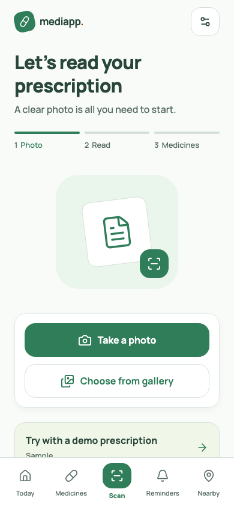
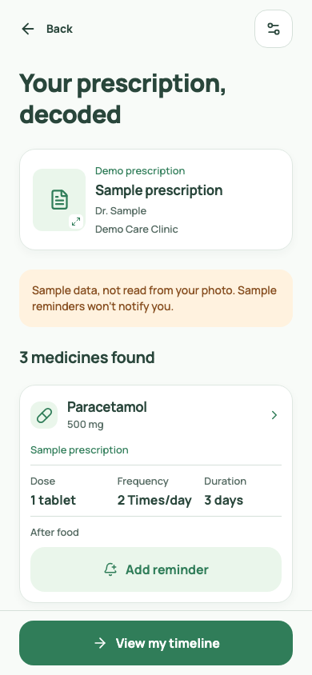
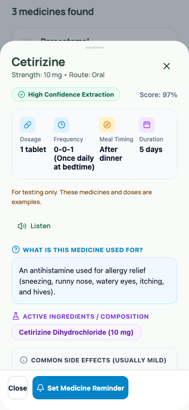
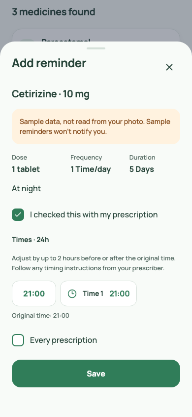
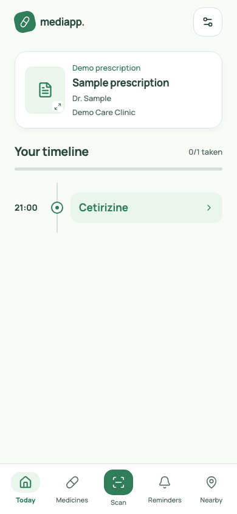
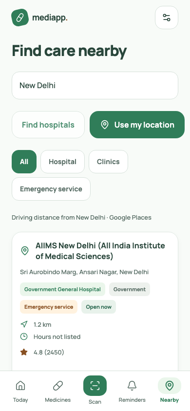
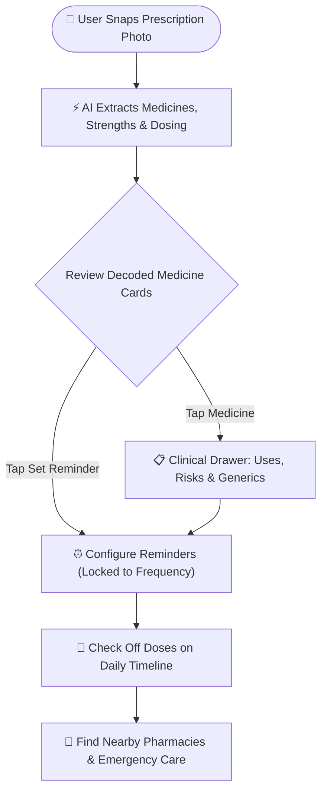
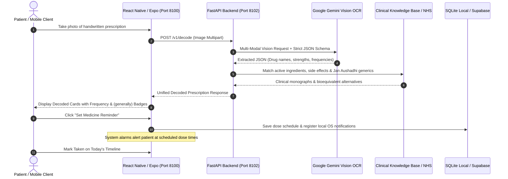

# 🩺 MediDecode — AI Prescription Decoder & Smart Medication Companion

[](https://reactnative.dev/)
[](https://expo.dev/)
[](https://fastapi.tiangolo.com/)
[](https://ai.google.dev/)
[](https://supabase.com/)
[](LICENSE)

> **MediDecode turns illegible handwritten prescriptions into verified medicine facts, plain-language dosage schedules (`3 Times/day`), affordable generic equivalents, and smart reminders.**

---

## 🚨 The Problem Statement

Handwritten prescriptions remain a dangerous, multi-billion-dollar bottleneck in patient healthcare:

```
      Doctor's Cursive Handwriting                   Patient Frustration & Risks
┌──────────────────────────────────────┐       ┌──────────────────────────────────────┐
│  • Illegible scrawl & abbreviations  │  ──►  │  • Dispensing & dosage errors        │
│  • "TDS", "BD", "HS", "0-0-1", "AC"  │       │  • No explanation of uses/side effects│
│  • No duration or dosage clarity     │       │  • Overpaying for costly brand names │
│  • Zero adherence tracking           │       │  • Missed doses & preventable illness│
└──────────────────────────────────────┘       └──────────────────────────────────────┘
```

| ❌ Real-World Problem | ✅ MediDecode Fix |
|:---|:---|
| **Illegible Doctor Cursive** | **Google Gemini Vision AI** transcribes handwritten scripts into validated clinical data. |
| **Cryptic Latin Shorthand** | Auto-translates abbreviations (`TDS`, `BD`, `1-0-1`, `HS`) into **`3 Times/day`**, **`2 Times/day`**, or **`At bedtime`**. |
| **Unspecified Treatment Length** | Intelligent clinical fallbacks surface safe standard durations labeled with **`(generally)`**. |
| **Lack of Drug Education** | In-app drawer explains **What it's used for**, **Active Salts**, **Mild Reactions**, and **Emergency Signs**. |
| **Expensive Branded Drugs** | Maps exact active salts to bioequivalent **Generic Alternatives** (e.g., PMBJP Jan Aushadhi). |
| **Medication Non-Adherence** | Auto-configures daily alarm reminders locked strictly to doctor-prescribed frequencies. |

---

## 📱 Application Preview

| 📸 1. Scan & Upload | 🩺 2. Decoded Prescription | 📋 3. Clinical Intelligence |
|:---:|:---:|:---:|
|  |  |  |
| *Capture prescription photo or select from gallery* | *Extracted medicines, dosages & standard frequencies* | *Confidence score, indications, side effects & generics* |

| ⏰ 4. Smart Reminders | 📅 5. Daily Adherence Timeline | 🏥 6. Nearby Healthcare |
|:---:|:---:|:---:|
|  |  |  |
| *Time slots locked to frequency with safety bounds* | *Check off doses, snooze, and track daily progress* | *Live GPS finder for verified government & private care* |

---

## ✨ Core Features

| Feature | What It Does |
|:---|:---|
| 🔬 **AI Prescription OCR** | Transcribes handwritten cursive into structured medicine names, strengths, and dosages using Google Gemini Vision. |
| 💊 **Standardized Frequencies** | Converts shorthand (`TDS`, `BD`, `1-0-1`, `HS`) into clean **`3 Times/day`**, **`2 Times/day`**, or **`At bedtime`**. |
| 📑 **Clinical Intelligence** | Bottom-sheet drawer explaining **Uses**, **Active Composition**, **Mild vs. Emergency Effects**, and **Precautions**. |
| 🏷️ **Generic Alternatives** | Recommends bioequivalent low-cost generics (e.g. PMBJP Jan Aushadhi) matched by active chemical salts. |
| ⏰ **Locked Safety Reminders** | Daily reminder slots locked to prescription frequency with anchored 2-hour safety adjustment limits. |
| 📅 **Adherence Timeline** | Daily timeline to track scheduled doses with one-tap **Mark Taken**, **Snooze (10m)**, and **Undo**. |
| 🏥 **Nearby Emergency Care** | Live GPS finder for verified **Government / Public hospitals**, 24/7 emergency rooms, and pharmacies. |
| 🔒 **100% Offline First** | Full local storage persistence — reminders and daily schedules work seamlessly without internet. |

---

## 🔄 How It Works: Workflows

### 👤 User Workflow



---

### ⚙️ Application Architecture Workflow



---

## 📂 Project Folder Structure

```
mediscan/
├── start.sh                       # 🚀 One-command system startup script (starts backend + frontend)
├── package.json                   # Root scripts & automation configuration
├── mobile/                        # React Native / Expo Frontend Application
│   ├── src/
│   │   ├── app/                   # Expo Router file-based screens
│   │   │   ├── (tabs)/            # Main navigation tabs
│   │   │   │   ├── index.tsx      # Today's Medication Timeline & dose tracker
│   │   │   │   ├── scan.tsx       # Camera capture, gallery picker & OCR decode
│   │   │   │   ├── medicines.tsx  # Decoded prescriptions & medicine list
│   │   │   │   ├── reminders.tsx  # Active schedules & alarm manager
│   │   │   │   └── hospitals.tsx  # Nearby GPS hospitals & emergency centers
│   │   │   └── _layout.tsx        # Navigation providers, safe-area & themes
│   │   ├── domain/                # Dosing math, scheduling safety & interval logic
│   │   ├── features/              # UI components (medicines.tsx, clinical drawer)
│   │   ├── lib/                   # API client, Supabase auth, notifications & i18n
│   │   └── ui/                    # Design tokens, bottom sheets, buttons & cards
│   ├── assets/                    # App branding, icons & splash screen
│   ├── tests/                     # Unit test suites & Playwright browser E2E tests
│   └── package.json               # Mobile dependencies & NPM scripts
│
├── backend/                       # FastAPI Python Backend Service
│   ├── gemini_decoder.py          # Google Gemini Vision prescription OCR pipeline
│   ├── main.py                    # API entrypoint, routes, CORS & rate-limiting
│   ├── reference.py               # FDA & NHS clinical monographs lookup service
│   ├── medicine_catalog.json      # Indian generic (Jan Aushadhi) pharmaceutical database
│   ├── run.py                     # Uvicorn production server launcher (Port 8102)
│   ├── requirements.txt           # Python backend dependencies
│   └── test_backend.py            # Pytest backend API verification suite
│
├── docs/                          # Project Documentation & Assets
│   ├── screenshots/               # Crystal-clear app preview screenshots (01 to 06)
│   ├── AI_ARCHITECTURE.md         # Multi-modal AI vision model architecture
│   └── SECURITY_AND_SAFETY.md     # Patient privacy & clinical non-fabrication policies
│
└── README.md                      # Project master documentation (You are here)
```

---

## 🚀 Quick Start: Running the Project

### 📋 Prerequisites
* **Node.js**: `v20+` (`node -v`)
* **Python**: `3.10+` (`python3 --version`)
* **Gemini API Key**: Free API key from [Google AI Studio](https://aistudio.google.com/)

---

### ⚡ Option A: One-Command Start (Recommended)

Run the included automated startup script from the root folder:

```bash
./start.sh
# or:
npm start
```

This single command automatically:
1. Verifies Python virtualenv, Node dependencies, and `GEMINI_API_KEY`.
2. Detects your computer's local Wi-Fi LAN IP (for phone connectivity).
3. Checks network ports (`8102` and `8100`) and frees stale connections.
4. Boots the **FastAPI Backend** and waits for its health check (`http://127.0.0.1:8102/health`).
5. Launches the **Expo Metro Bundler** with an interactive console and terminal QR code.
6. Handles single-command clean exit (`Ctrl + C`) for both services.

---

### 🛠️ Option B: Manual Terminal Launch

<details>
<summary><b>Click to expand manual 2-terminal startup steps</b></summary>

#### Step 1: Start Backend (Terminal 1)
```bash
cd backend
python3 -m venv .venv
source .venv/bin/activate       # Windows: .venv\Scripts\activate
pip install -r requirements.txt
cp .env.example .env            # Add your GEMINI_API_KEY
python run.py
```
> Running at: `http://127.0.0.1:8102` (Health: `curl http://127.0.0.1:8102/health`)

#### Step 2: Start Mobile App (Terminal 2)
```bash
cd mobile
npm install
echo "EXPO_PUBLIC_API_URL=http://localhost:8102" > .env
npm run start
```
Press **`w`** in the terminal to open immediately in your web browser!

</details>

---

### 📲 Running on Your Physical Mobile Phone

#### Method 1: Expo Go (Instant · 30 Seconds · Zero Build Required)
1. Install **Expo Go** from [Google Play Store](https://play.google.com/store/apps/details?id=host.exp.exponent) or [iOS App Store](https://apps.apple.com/app/expo-go/id982107779).
2. Connect your smartphone to the **same Wi-Fi network** as your computer.
3. Start the project using `./start.sh` (which auto-detects your LAN IP, e.g. `172.17.17.189`).
4. Scan the terminal QR code using **Expo Go** (Android) or the native **Camera** app (iOS).

#### Method 2: Standalone Android APK (`.apk`)
```bash
cd mobile
npm install -g eas-cli
eas login
npm run build:apk
```
EAS compiles a standalone native APK in the cloud and outputs a direct download link for any Android phone.

---

## 🧪 Testing & Verification

```bash
# 1. Run domain unit tests (Dose math, time window safety, status state machine)
npm test

# 2. Run automated browser E2E tests (10 full-flow Playwright scenarios)
npm run test:e2e

# 3. TypeScript validation
cd mobile && npx tsc --noEmit

# 4. Backend tests
cd backend && source .venv/bin/activate && pytest test_backend.py -v
```

---

## ⚠️ Medical Safety & Non-Fabrication Policy

> [!IMPORTANT]
> **MediDecode is an educational and organizational aid, not a licensed medical authority.**
>
> 1. **Zero Hallucination Constraint**: The AI model is strictly constrained against guessing unreadable cursive. Unclear inscriptions are marked as `Review Required`.
> 2. **Professional Verification**: Generic alternatives and active salts are surfaced for consultation with your doctor or pharmacist. Never substitute prescribed medicines without professional confirmation.
> 3. **Schedule Safety Boundary**: Patient time changes are restricted within a 2-hour window of the prescribed frequency to prevent unsafe dosage stacking.

---

## 📄 License

This project is licensed under the [MIT License](LICENSE).
