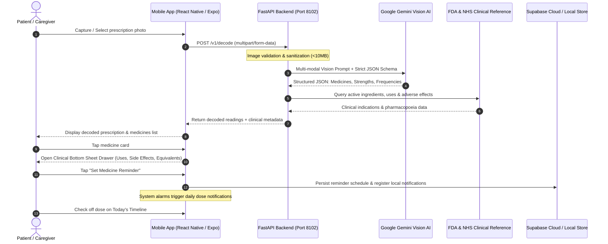

# MediDecode (MediScan) — AI-Powered Prescription Decoder & Medication Assistant

> **Transform handwritten doctors' prescriptions into clear, structured, clinical medicine intelligence, dosage schedules, generic alternatives, and smart adherence reminders.**

[](https://reactnative.dev/)
[](https://expo.dev/)
[](https://fastapi.tiangolo.com/)
[](https://ai.google.dev/)
[](https://supabase.com/)
[](LICENSE)

---

## 1. Problem Statement

Handwritten prescriptions remain a critical vulnerability in global healthcare delivery:

1. **Illegible Medical Handwriting**: Doctor cursive and shorthand frequently lead to prescription misinterpretation, dispensing errors by pharmacists, and patient confusion.
2. **Cryptic Medical Abbreviations**: Latin clinical notation (`TDS`, `BD`, `OD`, `HS`, `AC`, `PC`, `0-0-1`) creates steep comprehension barriers for patients and caregivers.
3. **Information Void**: Patients often leave clinics without understanding **what** their medicine does, what active salts it contains, what mild vs. emergency side effects exist, or what precautions (such as avoiding alcohol or driving) are required.
4. **Prohibitive Drug Costs**: Patients are rarely informed about affordable, bioequivalent generic alternatives (such as India's **PMBJP Jan Aushadhi** program or equivalent standard generic formulations).
5. **Poor Medication Adherence**: Over 50% of patients fail to take medications as directed, leading to complications, antimicrobial resistance, and avoidable hospitalizations.

**MediDecode** solves this end-to-end: patients snap a photo of any handwritten prescription and receive verified transcription, complete clinical breakdowns, generic alternatives, and smart scheduled reminders.

---

## 2. Core Capabilities & Purpose

* **AI Vision Prescription Transcription**: State-of-the-art multi-modal vision parsing using **Google Gemini** (`gemini-3-flash-preview` / `gemini-3.5-flash`) with constrained JSON schemas to extract medicine names, strengths, dosages, frequencies, and durations without hallucination.
* **Clinical Intelligence Bottom-Sheet Drawer**: Tapping any recognized medicine card opens a clinical drawer:
  * **Extraction Confidence Badge**: Visual confidence indicator (`High Confidence Extraction`) with percentage score.
  * **4-Grid Metric Card**: Clean breakdown of **Dosage**, **Frequency** (expanded plain-language schedule, e.g., `0-0-1 (Once daily at bedtime)`), **Meal Timing** (e.g., `After dinner`), and **Duration** (e.g., `7 days`).
  * **"What is this medicine used for?"**: Plain-language clinical indication explaining why the medicine was prescribed.
  * **Active Ingredients / Composition**: Formatted active salt badges with strengths.
  * **Common Side Effects (Usually Mild)**: Clean bulleted list of anticipated mild reactions (drowsiness, mild dizziness, dry mouth).
  * **Serious Warning Signs (Emergency)**: High-visibility warning box highlighting critical red flags requiring immediate physician contact.
  * **Safety, Allergies & Precautions**: Highlighting drug interactions, driving warnings, and food/alcohol restrictions.
  * **Possible Generic Equivalents**: Active-salt-matched generic substitutes (such as PMBJP Jan Aushadhi and standard branded generics) with manufacturer details and verification disclaimers.
  * **Sticky Action Bar**: Instant "Close" and "Set Medicine Reminder" buttons.
* **Medication Scheduling & Adherence**:
  * Customizable daily reminder timelines with exact alarms.
  * Smart safety windows (reminders constrained within 2 hours of physician instructions).
  * Food-timing alignment (`before`, `after`, or `with` meals).
  * Interactive dose check-offs (Mark Taken, Snooze, Undo).
* **Nearby Healthcare Facilities**:
  * Real-time GPS and city-based search for pharmacies, hospitals, and clinics.
  * Automatic classification into **Public / Government** vs. **Private** facilities with Google Maps directions.
* **Privacy-First & Offline-Ready**:
  * Client-side SQLite/AsyncStorage persistence ensures the schedule functions without internet access.
  * Opt-in Supabase authentication and encrypted cloud synchronization across devices.

---

## 3. End-to-End Workflow Architecture



---

## 4. Repository Structure

```
mediscan/
├── mobile/                   # React Native & Expo Mobile Client
│   ├── src/
│   │   ├── app/              # Expo Router file-based routing
│   │   │   ├── (tabs)/       # Tab screens: Today, Medicines, Scan, Reminders, Nearby
│   │   │   └── _layout.tsx   # Root navigation, theme & safe-area providers
│   │   ├── domain/           # Medication types, dosing rules & scheduling math
│   │   ├── features/         # Feature components (medicines.tsx, prescription.tsx, timeline.tsx)
│   │   ├── lib/              # API client, Supabase sync, i18n translations, local notifications
│   │   └── ui/               # Design system: Sheet drawer, Cards, Buttons, Color tokens
│   ├── assets/               # App icons, splash screens, and branding
│   ├── tests/                # Domain unit tests and Playwright E2E browser test suites
│   ├── app.json              # Expo application manifest, permissions & package config
│   ├── eas.json              # EAS cloud build configuration for Standalone Android APKs
│   └── package.json          # Mobile dependencies & NPM scripts
│
├── backend/                  # FastAPI Python Backend
│   ├── gemini_decoder.py     # Google Gemini multi-modal vision decoder service
│   ├── main.py               # FastAPI application entrypoint, CORS, rate-limiting & routes
│   ├── reference.py          # FDA, NHS, and Indian medicine catalog lookup service
│   ├── nhs_reference.py      # NHS Digital medicine monographs scraper/parser
│   ├── ocr.py                # Local PP-OCRv5 fallback runtime
│   ├── medicine_catalog.json # Curated Indian brand & generic composition database
│   ├── requirements.txt      # Python dependencies
│   ├── run.py                # Uvicorn server launcher
│   └── test_backend.py       # Pytest backend API verification suite
│
├── ai/                       # AI Training & Benchmark Utilities
│   ├── datasets/             # Prescription dataset manifests (DoD, RxHand, synthetic)
│   └── README.md             # Dataset documentation and training notes
│
├── docs/                     # Architectural & Research Documentation
│   ├── AI_ARCHITECTURE.md    # Multi-modal AI vision pipeline specs
│   ├── BENCHMARK_RESULTS.md  # OCR & extraction accuracy metrics
│   └── SECURITY_AND_SAFETY.md# Clinical safety guidelines & data protection
│
└── README.md                 # Project master documentation
```

---

## 5. Getting Started (Local Development)

### Prerequisites

* **Node.js**: `v20.x` or later (`node -v`)
* **npm**: `v10.x` or later
* **Python**: `v3.10` to `v3.14` (`python3 --version`)
* **Google Gemini API Key**: Free API key from [Google AI Studio](https://aistudio.google.com/)
* **Mobile Device / Emulator**: Physical Android or iOS phone with **Expo Go** installed (recommended) or an Android Virtual Device (AVD).

---

### Step 1: Backend Setup & Launch

1. Open a terminal and navigate to `backend/`:
   ```bash
   cd backend
   ```

2. Create and activate a Python virtual environment:
   ```bash
   python3 -m venv .venv
   source .venv/bin/activate
   ```

3. Install backend dependencies:
   ```bash
   pip install -r requirements.txt
   ```

4. Configure environment variables:
   ```bash
   cp .env.example .env
   ```
   Edit `backend/.env` with your API keys:
   ```env
   # Mandatory for prescription vision decoding:
   GEMINI_API_KEY=your_google_gemini_api_key_here
   GEMINI_MODEL=gemini-3-flash-preview

   # Supabase Configuration (Optional for cloud sync, app works offline without it):
   SUPABASE_URL=https://your-project.supabase.co
   SUPABASE_PUBLISHABLE_KEY=your_supabase_publishable_key

   # Google Places API Key (Optional for nearby hospital search):
   GOOGLE_PLACES_API_KEY=your_google_places_api_key_here
   ```

5. Start the FastAPI backend:
   ```bash
   python run.py
   ```
   *The backend will start at `http://0.0.0.0:8102`. You can test it in your browser at `http://127.0.0.1:8102/health`.*

---

### Step 2: Mobile Application Setup & Launch

1. In a second terminal, navigate to `mobile/`:
   ```bash
   cd mobile
   ```

2. Install JavaScript dependencies:
   ```bash
   npm install
   ```

3. Configure mobile environment variables:
   Create or verify `mobile/.env`:
   ```env
   # Point to your backend's LAN IP address (find using `ipconfig getifaddr en0` on macOS or `ipconfig` on Windows):
   EXPO_PUBLIC_API_URL=http://172.16.148.205:8102
   ```

4. Start the Expo development server:
   ```bash
   npm run start
   ```
   *Expo Metro Bundler will launch and display an interactive QR code.*

---

## 6. How to Generate & Install the Mobile App on Your Phone

You have **four options** to install and run the app on a mobile device, depending on your needs:

---

### Method A: Instant Mobile Installation via Expo Go (Fastest & Zero-Build)

This method lets you run the app on your physical smartphone with full access to native hardware (Camera, Haptics, Local Notifications, Storage) in under 30 seconds:

1. **Install Expo Go**:
   * **Android**: Download **Expo Go** from [Google Play Store](https://play.google.com/store/apps/details?id=host.exp.exponent).
   * **iOS**: Download **Expo Go** from [Apple App Store](https://apps.apple.com/app/expo-go/id982107779).
2. **Connect to the Same Wi-Fi Network**: Ensure your mobile phone and your development computer are connected to the same local Wi-Fi router.
3. **Scan the QR Code**:
   * On **Android**: Open the **Expo Go** app and tap **"Scan QR Code"** to scan the terminal barcode.
   * On **iOS**: Open the native **Camera** app, point it at the QR code, and tap the notification banner to open in Expo Go.
4. **Direct URL**: Alternatively, inside Expo Go, enter the project URL directly:
   ```
   exp://<YOUR-COMPUTER-IP>:8100
   ```

---

### Method B: Build a Standalone Android APK (`.apk`) via EAS Cloud Build

To distribute an installable standalone `.apk` file that anyone can install directly without installing Expo Go:

1. **Install EAS CLI globally**:
   ```bash
   npm install -g eas-cli
   ```

2. **Log into Expo** (create a free account at [expo.dev](https://expo.dev) if you don't have one):
   ```bash
   eas login
   ```

3. **Trigger the Cloud APK Build**:
   From inside the `mobile/` directory, run:
   ```bash
   npm run build:apk
   # Or directly:
   eas build -p android --profile preview
   ```

4. **Install on Phone**:
   * Expo's build servers will compile the native Android binaries in the cloud.
   * Once finished (typically 3–5 minutes), the terminal will print a **direct download URL** and a **QR code**.
   * Scan the QR code or open the link on your Android phone to download `app-release.apk` and tap **Install**.

*Note: The project comes pre-configured with `mobile/eas.json` setting `"buildType": "apk"` under the `preview` profile so that a directly sideloadable `.apk` file is generated.*

---

### Method C: Local Standalone Build using Android Studio / Gradle

If you have Android Studio and a local JDK installed on your computer:

1. **Generate the native Android project**:
   ```bash
   cd mobile
   npx expo prebuild --platform android
   ```
   *This outputs the complete native Gradle project into `mobile/android/`.*

2. **Compile the APK with Gradle**:
   ```bash
   cd android
   ./gradlew assembleRelease
   ```

3. **Locate and Transfer the APK**:
   The compiled APK will be located at:
   ```
   mobile/android/app/build/outputs/apk/release/app-release.apk
   ```
   Connect your Android phone via USB and transfer the APK, or install via ADB:
   ```bash
   adb install app/build/outputs/apk/release/app-release.apk
   ```

---

### Method D: Progressive Web App (PWA) Mobile Installation

If you prefer installing directly from a browser without app store files:

1. Open your mobile browser (Chrome / Safari) and visit:
   ```
   http://<YOUR-COMPUTER-IP>:8100
   ```
2. Tap the browser menu (**⋮** on Chrome or **Share** icon on Safari).
3. Select **"Add to Home Screen"** or **"Install App"**.
4. The MediDecode icon appears directly on your phone's home screen and launches in fullscreen standalone mode.

---

## 7. Running Tests & Quality Verification

### Run Mobile Unit Tests
```bash
cd mobile
npm test
```
*Verifies medication scheduling mathematics, time window safety algorithms, dose status transitions, and offline persistence rules.*

### Run Playwright Browser E2E Tests
```bash
cd mobile
npm run test:e2e
```
*Executes automated headless browser tests covering onboarding, photo decoding, drawer rendering, and timeline interactions.*

### Run Backend Tests
```bash
cd backend
source .venv/bin/activate
pytest test_backend.py -v
```
*Verifies image dimension validation, rate-limiting, hospital search endpoints, and Gemini vision integration.*

---

## 8. Clinical Safety & Medical Non-Fabrication Policy

> [!IMPORTANT]
> **MediDecode is an assistive tool for patient understanding and adherence, not a licensed medical prescriber.**
>
> 1. **Zero Hallucination Constraint**: The AI model is instructed never to guess illegible doctor handwriting. If an inscription is ambiguous, the app explicitly marks it as `Review Required`.
> 2. **Professional Verification Required**: Possible generic alternatives and active salt equivalences are surfaced strictly for educational reference and pharmacist consultation. Patients are explicitly warned never to substitute prescribed medications without professional medical approval.
> 3. **Schedule Safety Boundary**: Patient-adjusted reminder times are restricted to a 2-hour window relative to the original prescription to prevent unsafe dosage clustering.

---

## 9. License

This project is licensed under the [MIT License](LICENSE).
